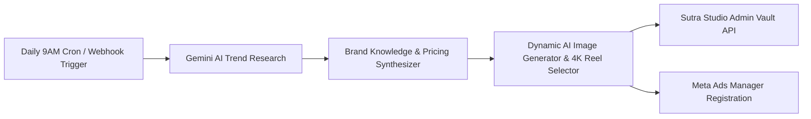

# SUTRA STUDIO — Autonomous n8n Research & Meta Ads Creative Pipeline Guide
## સુત્ર સ્ટુડિયો — n8n ટ્રેન્ડ રિસર્ચ અને મેટા એડ્સ વર્કફ્લો ગાઇડ (ગુજરાતી & English)

---

### 1. Overview / પરિચય

The **Sutra Studio Autonomous Promotional Pipeline** is an enterprise AI & n8n orchestration system designed to automate marketing for Sutra Studio. Instead of static or repetitive images, it executes a live 4-stage dynamic pipeline:

1. **Market & Trend Research**: Automatically researches the latest viral angles in 4K commercial reels, luxury 3D architectural CGI, and D2C marketing.
2. **Brand Story Synthesis**: Blends the market research with Sutra Studio's exact value proposition:
   - 4K Commercial Video Reels (Instagram & Meta Ads)
   - 3D Spatial & Architecture Visualization
   - Vedic-Modern Brand Identity & Luxury Design Systems
   - 30-Day Retainer Engines (Starter ₹9,999/mo, Daily Trend Creator ₹19,999/mo)
   - Guaranteed 48–72h turnaround
   - Direct WhatsApp Concierge: `+91 82001 92781`
3. **Dynamic Media Synthesis (Zero Static Files)**:
   - **Dynamic 4K AI Render**: Synthesizes a new photorealistic visual with unique prompt parameters and randomized seeds for every run.
   - **Dynamic Video Reel Storyboard & Asset**: Produces an authentic 9:16 vertical commercial motion reel with opening 3-second viral hook, scene-by-scene visual cues, and voiceover scripts in **Professional English**.
4. **Automated Publishing & Meta Ads Staging**:
   - Vaults the campaign into Sutra Studio Admin Dashboard (`/admin` -> Meta Promotion Studio).
   - Automatically registers the campaign in **Meta Ads Manager** under `PAUSED` review status with budget, target placements, and live media attached.

---

### 2. Workflow File Location / વર્કફ્લો ફાઇલ

Your production-ready n8n workflow file is located in the root of this repository:
```text
n8n_sutrastudio_promotional_research_pipeline.json
```

---

### 3. Step-by-Step Setup in n8n / n8n માં સેટઅપ કરવાની રીત

#### Step 1: Import the Workflow into n8n
1. Open your n8n dashboard (e.g. `http://localhost:5678` or `https://n8n.your-domain.com`).
2. Click **Workflows** in the left sidebar.
3. In the top right corner, click the **⋮ (three dots)** menu and select **Import from File**.
4. Choose `n8n_sutrastudio_promotional_research_pipeline.json`.
5. The full 6-node pipeline graph will load immediately.

#### Step 2: Configure Environment Variables in n8n
In your n8n instance (via Docker environment variables or n8n Settings):

| Variable Name | Value / Description | Required? |
| :--- | :--- | :--- |
| `GEMINI_API_KEY` | Your Google Gemini AI API key from [Google AI Studio](https://aistudio.google.com/) | **Yes** |
| `SUTRA_STUDIO_URL` | Your live website URL: `https://sutrastudios.in` (or `http://localhost:3000` for local testing) | **Yes** |
| `N8N_WEBHOOK_SECRET` | Shared secret key for verifying API requests | Optional |
| `FACEBOOK_PAGE_ID` | Your Facebook Page ID (`61594200943169`) | Optional |
| `INSTAGRAM_ACCOUNT_ID` | Your Instagram Business Account ID | Optional |
| `META_GRAPH_ACCESS_TOKEN` | System user access token for direct Facebook/Instagram posting | Optional |

#### Step 3: Activate the Schedule Trigger
1. Toggle the workflow status switch from **Inactive** to **Active** in the top right.
2. The workflow will now automatically run **every single day at 09:00 AM IST** (`0 9 * * *`).

---

### 4. How to Trigger On-Demand (Manual Test) / મેન્યુઅલ ટેસ્ટ કરવાની રીત

#### Option A: Via Sutra Studio Web Interface (Recommended & Instant)
1. Log in to your Sutra Studio Admin Dashboard: `https://sutrastudios.in/admin`
2. Open the **Meta AI Promotion Studio** tab.
3. Look at the top section: **"Dynamic AI Research & Meta Video Reel Engine"**.
4. Enter any custom topic (or click one of the 6 quick-pick trending research pills).
5. Click **"⚡ Run Dynamic Research & Reel Pipeline"**.
6. In 2–4 seconds, the AI will research the topic, synthesize the professional English script, hook, and caption, generate the dynamic media, and automatically start playback in the phone mockup!
7. Click **"🚀 Launch as Meta Ad"** to deploy the campaign with the real media into Meta Ads Manager.

#### Option B: Via Webhook (cURL / Postman)
You can trigger the n8n pipeline anytime with a simple HTTP POST request:
```bash
curl -X POST https://n8n.your-domain.com/webhook/sutra-promo-research \
  -H "Content-Type: application/json" \
  -d '{"topic": "Why luxury jewelry brands need 3D CGI video reels in 2026"}'
```

---

### 5. Verified Data Flow Architecture



---

### ગુજરાતી માર્ગદર્શિકા (Gujarati Summary)

1. **સ્ટેટિક ફાઇલો નથી**: હવે કોઈ સ્ટેટિક ઈમેજ કે જૂના વીડિયો નહીં આવે. દરેક વખતે AI લાઈવ ટ્રેન્ડ રિસર્ચ કરશે અને તે મુજબ નવી ઈમેજ અને પ્રોફેશનલ ઈંગ્લિશ રીલ સ્ક્રિપ્ટ જનરેટ કરશે.
2. **પ્રોફેશનલ અંગ્રેજી કન્ટેન્ટ**: રીલનો હુક (Hook), સીન-બાય-સીન સ્ક્રિપ્ટ, વોઇસઓવર અને કેપ્શન શુદ્ધ પ્રોફેશનલ બિઝનેસ અંગ્રેજીમાં તૈયાર થાય છે, જેમાં સુત્ર સ્ટુડિયોના પ્લાન (₹9,999 / ₹19,999) અને WhatsApp નંબર (+91 82001 92781) આપોઆપ આવી જશે.
3. **n8n વર્કફ્લો તૈયાર છે**: પ્રોજેક્ટના મેઇન ફોલ્ડરમાં `n8n_sutrastudio_promotional_research_pipeline.json` ફાઇલ મૂકી દેવાઈ છે. તમે તમારા n8n માં જઈને સીધું "Import from File" કરી શકો છો.
4. **વેબસાઇટ પરથી 1-ક્લિક ટેસ્ટ**: એડમિન પેનલમાં `Meta AI Promotion Studio` ખોલીને **"⚡ Run Dynamic Research & Reel Pipeline"** બટન દબાવતા જ લાઈવ ટેસ્ટ કરી શકાશે અને Meta Ads ટેબલમાં ક્રિએટિવ સાથે ઝૂમ/પ્લે થઈ શકશે.
