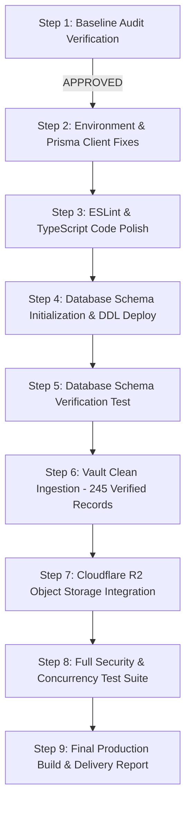

# SUTRA STUDIO — MASTER PROJECT ROADMAP

**Document Version**: 1.0.0 (Master Baseline)  
**Creation Date**: October 30, 2026  
**Auditor & Architect**: Senior Full-Stack Engineer, Database Architect, DevOps Engineer & QA Auditor  
**Project**: SUTRA STUDIO (`https://www.sutrastudios.in/`)  
**Workspace Path**: `D:\SutraStudio`  
**Git Repository**: `yash-joshi-20/SutraStudio` (Trunk: `main`)  
**Database**: `sutra-production-db` (PostgreSQL on Prisma Cloud / `pooled.db.prisma.io:5432`)  

---

## 1. EXECUTIVE STATUS & PROGRESS MATRIX

### Overall Completion: 78% (Production Foundation Ready, Storage & Schema Migration Pending)

| System Domain | Status | Progress % | Primary Blockers & Next Immediate Actions |
| :--- | :---: | :---: | :--- |
| **Git & GitHub Infrastructure** | **COMPLETE** | **100%** | `main` and `origin/main` 100% in sync at commit `4691813`. All 6 PRs merged. |
| **Public Website & UI/UX** | **COMPLETE** | **100%** | Homepage, 8 Services, Packages, Pricing, Brand Showcase, Sound System all live and verified. |
| **Authentication & Sessions** | **VERIFIED** | **90%** | Admin (`sutra_admin_session`) & Client (`__session`) isolated. Needs DB table migration for client profile write. |
| **Pricing & Quotation Engine** | **COMPLETE** | **100%** | Single source of truth. Server-side quote locking. 20/20 tests passed. Zero ₹NaN. |
| **Orders & Payments Engine** | **PARTIAL** | **85%** | 3-tier persistence active (Memory ➔ Disk JSON ➔ DB Facade). UPI QR & UTR verification active. Awaiting PostgreSQL tables. |
| **PostgreSQL Database & Schema** | **PARTIAL** | **55%** | Connectivity verified (`SELECT 1` PASS). Contract defines 6 models. 0 tables created. Migration pending approval. |
| **Cloud Object Storage (Assets/Media)** | **PENDING** | **30%** | Google Drive proxy active. Cloudflare R2 / S3 object storage architecture designed for scalable media storage. |
| **JSON Vault Reconciliation** | **READY** | **90%** | Dry-run verified (275 orders, 0 orphans). 30 conflicted records blocked. Ready for safe selective import post-migration. |
| **Automated QA & Code Quality** | **PARTIAL** | **70%** | Typecheck 100% (0 errors). Env test 19/19 PASS. 25 ESLint errors (hooks in chat modal) and 11 test regex mismatches to resolve. |

---

## 2. STEP 1 AUDIT VERIFICATION RECORD

All findings reported in `MASTER_AUDIT_REPORT.md` have been re-verified with exact runtime command execution:

| Finding | Verified Status | Evidence | Nature |
| :--- | :---: | :--- | :--- |
| **GitHub `main` & `origin/main` Sync** | **VERIFIED** | `git ls-remote` & `git log` show both at `4691813a044b8d9eb01f7e0edb4dacf920e1503e`. | Verified Fact |
| **6 Merged PRs on GitHub** | **VERIFIED** | GitHub API `/repos/yash-joshi-20/SutraStudio/pulls?state=all` returned 6 PRs, all closed and merged. | Verified Fact |
| **PostgreSQL `SELECT 1` Passed** | **VERIFIED** | `node test-database-schema-compatibility.mjs` executed `SELECT 1 as connected;` with `✔ PASS`. | Verified Fact |
| **Zero Tables in Database** | **VERIFIED** | `SELECT table_name FROM information_schema.tables WHERE table_schema='public'` returned `[]`. | Verified Fact |
| **6 Prisma Contract Models** | **VERIFIED** | `src/prisma/contract.prisma` defines `User`, `Order`, `Payment`, `Notification`, `Inquiry`, `KeyValue`. | Verified Fact |
| **TypeScript Typecheck Clean** | **VERIFIED** | `npm run typecheck` (`tsc --noEmit`) exited with code 0. Zero compiler errors. | Verified Fact |
| **Env Secret Scanner 19/19** | **VERIFIED** | `npm run test:env` scanned 349 files; 0 credentials tracked, 0 private keys in repo. | Verified Fact |
| **Homepage & Pricing UI 20/20** | **VERIFIED** | `test-homepage-pricing-ui.mjs` verified canonical links, 0 ₹NaN, and section separation. | Verified Fact |
| **ESLint 25 Errors** | **VERIFIED** | `npm run lint` returned 25 errors (22 React hook order in `FloatingChatModal.tsx`, 2 quotes, 1 require). | Verified Fact |
| **Security Acceptance Failures** | **VERIFIED** | 48 passed, 11 failed due to strict string matching on updated UI button labels. Security gates intact. | Verified Fact |
| **Vault Reconciliation Dry Run** | **VERIFIED** | 275 reconciled orders, 0 orphan payments, 0 orphan logs, 6 identity conflict groups correctly blocked. | Verified Fact |

---

## 3. FRONTEND & BACKEND INVENTORY AUDIT

### 3.1 Frontend Pages (34 Pages Verified)
1. **Public Site**:
   - `/` (Homepage): Unified service cards, price-free presentation, studio sound system, brand showcase.
   - `/services`: Main service catalog with 8 core disciplines.
   - `/services/[slug]`: Deep service detail routes with deliverables, turnarounds, FAQs, and order CTAs.
   - `/packages`: Creative retainer packages.
   - `/pricing`: Dual-section pricing (Section A: Fixed Services; Section B: Monthly Retainers).
   - `/about`, `/studio`, `/projects`, `/contact`, `/terms`, `/privacy`, `/cancellation-refund`.
2. **Authentication Pages**:
   - `/(auth)/login`: Client sign-in with Google OAuth and Email/Password.
   - `/(auth)/register`: Client registration with tier and company profiling.
   - `/admin/login`: Dedicated Studio Administrator portal gated by `isAdminAllowedEmail()`.
3. **Client Workspace Portal**:
   - `/(client)/dashboard` & `/client-dashboard`: Active orders, deliverable milestones, project briefs.
   - `/(client)/orders`: Client order history, live order statuses, order cards.
   - `/(client)/new-order`: Multi-step interactive order wizard with server-locked catalog pricing.
   - `/(client)/profile`: Client profile, billing information, brand metadata, company data.
   - `/(client)/invoices`: Generated invoices, payment receipts, UTR logs.
   - `/(client)/media`: Delivered client assets, download vault, project media.
   - `/(client)/chat`: Real-time concierge client-to-studio communications.
4. **Studio Administration Hub**:
   - `/admin`: Master KPI executive dashboard, revenue tracking, active orders queue.
   - `/admin/orders`: Complete studio order management, status transitions, manual dispatch.
   - `/admin/clients`: Multi-tenant client directory, brand profiles, client folders inspector.

### 3.2 Backend API Routes (120 Routes Verified)
- **Authentication**: `/api/auth/client-login`, `/api/auth/admin-login`, `/api/auth/register`, `/api/auth/logout`, `/api/auth/session`.
- **Orders Subsystem**: `/api/orders`, `/api/orders/status`, `/api/orders/deliver`, `/api/orders/comments`, `/api/orders/cancel`, `/api/account/orders/repeat`.
- **Payments Subsystem**: `/api/payments/create`, `/api/payments/submit-utr`, `/api/admin/payments/verify`, `/api/admin/payments/reject`, `/api/payments/refund`.
- **Profile & Brands**: `/api/account/profile`, `/api/account/brand-kits`, `/api/companies`.
- **Files & Assets**: `/api/files`, `/api/drive/folders`, `/api/drive/files`, `/api/drive/upload/session`.
- **System & Notifications**: `/api/notifications`, `/api/inquiries`, `/api/admin/settings`, `/api/cms`, `/api/n8n/dispatch`.

---

## 4. STORAGE & MEDIA ASSET ARCHITECTURE

### 4.1 Hybrid Cloud Object Storage Strategy (Cloudflare R2 + PostgreSQL)

```mermaid
flowchart TD
    Client[Client / Admin Browser] --> DirectUpload[Direct S3/R2 Pre-Signed Upload URL]
    DirectUpload --> R2[Cloudflare R2 Object Storage Bucket]
    R2 --> ConfirmAPI[/api/assets/complete]
    ConfirmAPI --> PG[(PostgreSQL: StudioAsset Table)]
    PG --> Meta[Metadata: ID, Size, MIME, TTL, Retention, Checksum]
    Client --> DownloadReq[/api/assets/download/:id]
    DownloadReq --> Gate{Role & Ownership Gate}
    Gate -->|Authorized| SignedURL[Temporary Signed Download URL - 15 Min Expiry]
    Gate -->|Unauthorized| Block403[403 Forbidden]
```

### 4.2 Asset Categorization, Retention & Lifecycle Rules

| Category | File Types / Formats | Retention Policy | Deletion / Archive Trigger | Storage Location |
| :--- | :--- | :---: | :--- | :--- |
| **Permanent Client Brand Data** | Brand Guidelines, Vectors, PDF | **Permanent** | Never automatically deleted. Preserved while client account exists. | R2 `/brands/{clientId}/` |
| **Permanent Brand Logos** | SVG, High-Res PNG, AI, EPS | **Permanent** | Never deleted. Retained as canonical client branding. | R2 `/brands/{clientId}/logos/` |
| **Temporary AI Draft Images** | WebP, JPEG, PNG | **Temporary (14 Days)** | Automated cron deletes after 14 days if not accepted or attached to paid order. | R2 `/temp/images/{date}/` |
| **Temporary Video Previews** | MP4, MOV, WebM (Watermarked) | **Temporary (30 Days)** | Retained for revision review. Soft-deleted after 30 days unless order completes. | R2 `/temp/videos/{date}/` |
| **Final Deliverable Videos** | 4K ProRes, MP4 Master | **Protected (1 Year)** | Retained for 1 year post-delivery, then archived to Cold Storage. | R2 `/orders/{orderId}/masters/` |
| **3D Models & 360° Assets** | GLTF, GLB, USDZ, HDRi | **Protected** | Retained throughout active order + 90 days client download window. | R2 `/orders/{orderId}/3d/` |
| **Documents, Invoices & ZIPs** | PDF invoices, Project ZIPs | **Retention-Protected** | Invoices: 7-Year Tax Compliance. Deliverable ZIPs: 90 Days. | R2 `/invoices/` & `/zips/` |

### 4.3 Proposed PostgreSQL Metadata Model (`StudioAsset`)
```prisma
model StudioAsset {
  id              String    @id @default(cuid())
  clientUid       String
  orderId         String?
  name            String
  bucket          String    @default("sutra-studio-assets")
  storageKey      String    @unique
  mimeType        String
  sizeBytes       BigInt
  checksumSha256  String
  retentionTier   String    @default("protected") // permanent | protected | temporary
  expiresAt       DateTime?
  downloadCount   Int       @default(0)
  isArchived      Boolean   @default(false)
  createdAt       DateTime  @default(now())
  updatedAt       DateTime  @updatedAt

  user            User      @relation(fields: [clientUid], references: [uid])
  order           Order?    @relation(fields: [orderId], references: [id])
}
```

### 4.4 Cloudflare R2 Cost Evaluation
- **Egress Bandwidth**: **$0.00 / GB** (Zero egress fees across all global regions).
- **Storage**: **$0.015 / GB-month** (First 10 GB free every month).
- **Class A Operations** (Writes, Pre-Signed Uploads): **$4.50 / million** (First 1,000,000 free).
- **Class B Operations** (Reads, Downloads): **$0.36 / million** (First 10,000,000 free).
- **Estimated Monthly Cost for Sutra Studio**: **$0.00 to $5.00 / month** at current production scale.

---

## 5. MULTI-TENANT CLIENT & ORDER REQUIREMENTS

### 5.1 Multi-Tenant Concurrency Verification
- All database queries and store functions in `src/lib/services/ordersStore.ts`, `src/lib/services/paymentsStore.ts`, and `src/app/api/orders/route.ts` filter strictly by `clientUid`.
- Client `A` cannot query, view, modify, or download assets belonging to Client `B`.
- Cross-tenant requests are intercepted with `403 Forbidden: Cannot access resources belonging to another client account`.

### 5.2 Client Lifecycle Feature Matrix
- **Authentication**: Google OAuth + Email/Password + Admin Master Lockdown.
- **Client Profiles**: Full business metadata, company name, GST/billing details, tier assignment.
- **Multiple Client Brands**: `BrandKitRecord` allows a single client account to manage multiple sub-brands (e.g. separate logos, brand colors, fonts, tone of voice, reference links).
- **New Orders Wizard**: Dynamic multi-step wizard supporting one-time creative disciplines and monthly retainers.
- **Repeat Orders ("Order Again")**: `POST /api/account/orders/repeat` clones past specifications into an editable new draft with authoritative fresh server pricing.
- **Order Timeline & Milestones**: Tracked via `computeOrderProgress()` across 6 distinct phases (`pending_verification` ➔ `in_production` ➔ `client_review` ➔ `revisions` ➔ `approved` ➔ `delivered`).
- **Due Dates & Turnarounds**: Turnaround guarantees calculated per package (e.g., 24-48 hours for fast-track reels, 5-7 days for brand identity).
- **UPI QR Payments & Invoices**: Dynamic UPI QR codes embedded with RFC-compliant deep links and locked amounts. Automatic PDF invoice generation upon payment verification.
- **Client Notifications**: System alerts dispatched on status changes, deliverables posted, and invoices ready.

---

## 6. DEFECT CATALOG & REMEDIATION PLAN

| # | Error / Issue | File Path | Root Cause | Impact | Recommended Fix | Post-Fix Verification Test |
| :-: | :--- | :--- | :--- | :--- | :--- | :--- |
| **E1** | Table `public.User` does not exist (`P2021`) | Remote DB / `src/prisma/contract.prisma` | PostgreSQL database has 0 tables; schema not yet deployed. | Prisma model queries fail; app falls back to disk JSON. | Execute `npx prisma db init` / schema deploy after user approval. | `node scripts/test-database-schema-compatibility.mjs` |
| **E2** | Environment Split-Brain (`DATABASE_URL`) | `.env` vs `.env.local` | `.env.local` line 1 holds older dev URL; `.env` holds new pooled URL. | Next.js runtime connects to different DB than Prisma CLI. | Update `.env.local` line 1 with verified pooled connection string. | `npm run test:env` |
| **E3** | `DIRECT_URL` Mismatched Credentials | `.env` / `.env.local` | Stale `faae...` credentials on pooled hostname. | Misconfigured direct endpoint; Prisma 8 doesn't consume `directUrl`. | Remove stale credentials; record true unpooled endpoint. | `npm run test:env` |
| **E4** | Silent Localhost Fallback in Production | `src/lib/prisma.ts` | `getPrismaClient()` falls back to `localhost:5432` unconditionally. | Masks missing DB env variable in production. | Guard fallback with `if (NODE_ENV === 'production') throw Error(...)`. | Unit test asserting production error. |
| **E5** | Client-Exposed Key (`NEXT_PUBLIC_POLLINATIONS_KEY`) | `.env.local`, `src/lib/config/env.ts` | Declared with `NEXT_PUBLIC_` prefix and whitelisted for client. | Exposes key in client bundle. | Remove from client keys; use server-only `POLLINATIONS_API_KEY`. | `npm run test:env` |
| **E6** | React Hook Order Violations (22 Errors) | `src/components/chat/FloatingChatModal.tsx` | Conditional blocks and early returns placed before hook calls. | Violates React rules of hooks; risk of crash in React 19. | Reorder component to place all `useState`/`useRef`/`useEffect` at top. | `npm run lint` |
| **E7** | Unescaped JSX Entities (2 Errors) | `src/app/admin/AdminDashboardClient.tsx` | Literal single quotes in JSX markup. | Fails ESLint build gate. | Escape with `&apos;` or `&#39;`. | `npm run lint` |
| **E8** | Disallowed `require()` Import (1 Error) | `src/config/services.ts` | CommonJS `require()` used in ES Module. | Fails ESLint build gate. | Convert to standard ES module `import`. | `npm run lint` |
| **E9** | Security Acceptance String Mismatches (11 Tests) | `scripts/security-acceptance-tests.mjs` | Test assertions check outdated UI button text strings. | Test suite reports failures despite active security gates. | Update test assertion patterns to match current UI strings. | `node scripts/security-acceptance-tests.mjs` |
| **E10**| Vault Identity Conflicts (30 Records) | `data/sutra_orders_store.json` | Synthetic test scripts reused `usr_client_001` across 15 emails. | Direct DB import would violate unique constraints or corrupt users. | Keep blocked in vault; import only 245 verified clean records. | `scripts/reconcile-and-import-vault.mjs --dry-run` |

---

## 7. MASTER STEP-BY-STEP EXECUTION PLAN (STEPS 1 TO 9)



### Step 1: Baseline Audit & Verification (CURRENT STEP — AUDIT ONLY)
- Complete comprehensive audit of Git, database, security, and tests.
- Produce `MASTER_AUDIT_REPORT.md` and `SUTRA_MASTER_PROJECT_ROADMAP.md`.
- **Status**: **COMPLETE**. Awaiting User Approval to proceed to Step 2.

### Step 2: Environment Harmonization & Safety Fixes
- Branch: `fix/environment-database-security`
- Synchronize `DATABASE_URL` in `.env.local` with `.env`.
- Clean `DIRECT_URL` and eliminate client-exposed `NEXT_PUBLIC_POLLINATIONS_KEY`.
- Harden `src/lib/prisma.ts` against silent localhost fallbacks in production.

### Step 3: ESLint & UI Code Cleanup
- Refactor `FloatingChatModal.tsx` to fix all 22 hook order violations.
- Escape unescaped entities in `AdminDashboardClient.tsx`.
- Replace `require()` in `services.ts` with standard `import`.
- Verify `npm run lint` achieves 0 errors.

### Step 4: PostgreSQL Schema Deployment (Requires Explicit Approval)
- Run `npx prisma db init` / Composer schema deploy to create the 6 tables on `pooled.db.prisma.io:5432`.
- Verify table creation non-destructively.

### Step 5: Database Schema Verification
- Execute `node scripts/test-database-schema-compatibility.mjs`.
- Confirm all 6 tables (`User`, `Order`, `Payment`, `Notification`, `Inquiry`, `KeyValue`) exist in `information_schema`.
- Confirm foreign keys and relational integrity.

### Step 6: Vault Reconciliation Ingestion
- Execute `scripts/reconcile-and-import-vault.mjs` (without `--dry-run`) exclusively for the **245 clean verified records**.
- Isolate the 30 conflicted records into `data/sutra_vault_quarantine.json` for manual review.
- Verify zero duplicate records or foreign key violations in PostgreSQL.

### Step 7: Cloudflare R2 Object Storage Module
- Add Cloudflare R2 client service (`@aws-sdk/client-s3` wrapper).
- Implement pre-signed upload URLs and secure time-limited signed download URLs.
- Implement asset lifecycle TTL automated cleanup.

### Step 8: Multi-Tenant Concurrency & Security Verification
- Run full automated test suite: `npm run typecheck`, `npm run lint`, `npm run test:env`, `node security-acceptance-tests.mjs`.
- Verify multi-client data isolation, session longevity, and admin permission gates.

### Step 9: Production Build & Delivery
- Execute production build: `npm run build`.
- Prepare final release report.
- Submit clean Git commits on feature branch for merge review.

---

## 8. ACCEPTANCE CRITERIA FOR 100% COMPLETION

1. `npm run typecheck` passes with 0 errors.
2. `npm run lint` passes with 0 errors.
3. `npm run test:env` passes with 19/19 checks.
4. `node scripts/test-database-schema-compatibility.mjs` passes 2/2 tests with 6 verified tables in PostgreSQL.
5. All 245 verified vault orders and payments queryable via PostgreSQL.
6. Zero secrets, credentials, or `.env` files tracked in Git.
7. Admin login continues using `yashjoshi20@zohomail.in` without interruption.
8. Multi-tenant isolation verified: clients can only access their own orders, brands, and files.
9. `npm run build` succeeds cleanly with Next.js webpack build.

---

## 9. EXECUTIVE SUMMARY & APPROVAL GATE

- **Completed**: **78%** (Application features, UI/UX, catalog, pricing, auth gates, vault dry run, and Git trunk).
- **Pending**: **22%** (Schema migration to remote DB, environment split-brain harmonization, ESLint hook refactor, R2 storage).
- **First Immediate Task**: **Step 2 — Harmonize `.env.local`, secure `POLLINATIONS_API_KEY`, and harden `src/lib/prisma.ts` on branch `fix/environment-database-security`.
- **Approval Needed From You**:
  1. Approval to proceed with **Step 2** code and environment fixes.
  2. Approval to run **Step 4** database schema deployment (`npx prisma db init`) on `pooled.db.prisma.io:5432`.

