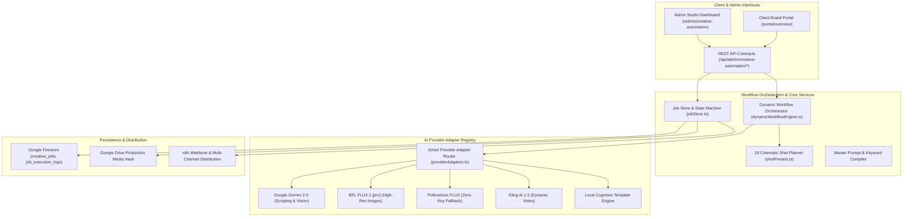
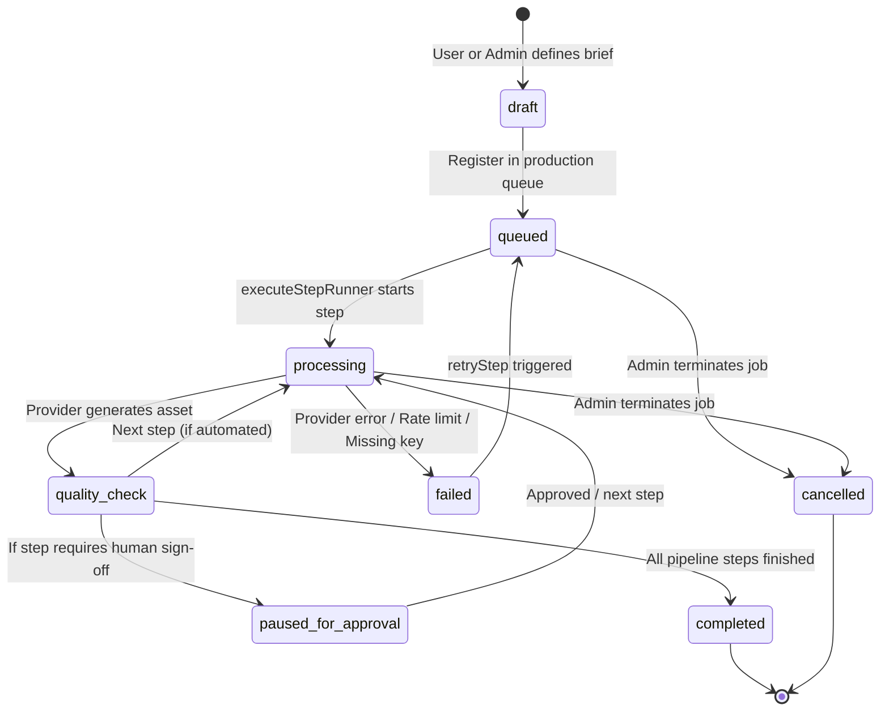
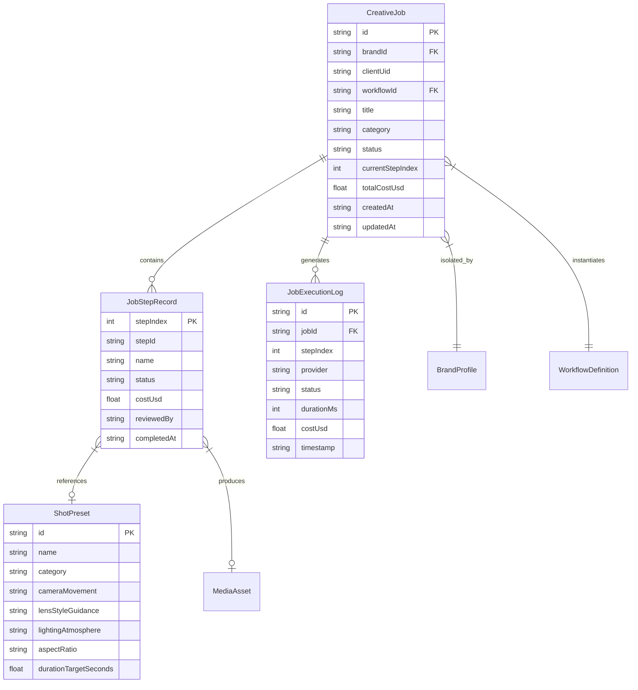

# 02 — System Architecture & Data Flow

The Sutra Studio AI Creative Automation Engine is engineered as a modular, extensible orchestration platform integrated directly inside Next.js App Router and Node.js. It bridges creative direction briefs, AI generation engines, cloud storage vaults, and multi-tenant admin dashboards without introducing secondary microservices or SQL databases.

---

## 🏗️ High-Level System Architecture

---

## 🔄 Job State Machine

Each creative production job strictly transitions through well-defined lifecycle states:

### State Definitions

1. `draft`: Job parameters and creative brief are defined but not queued for execution.
2. `queued`: Job is registered in Firestore / memory queue and pending invocation of Step 1.
3. `processing`: An active step runner is interacting with an AI provider adapter.
4. `quality_check`: Generated output (resolution, format, prompt fidelity) is undergoing validation.
5. `paused_for_approval`: Execution is held at a designated human approval gate for Creative Director review.
6. `completed`: All dynamic steps are executed and deliverables are synced with Google Drive.
7. `failed`: Execution encountered an unrecoverable provider failure, timeout, or missing credential.
8. `cancelled`: Administrator manually stopped the job.

---

## 📦 Core Domain Entities

---

## 🛡️ Architecture Invariants

- **No SQL Database**: All job metadata, tenant settings, and step execution records are saved in Firebase Firestore and synchronized with in-memory mirrors.
- **Client Segregation**: Client dashboards (`/portal/*`) only receive finalized deliverable URLs and approved status strings. Internal prompts, provider configurations, error traces, and API keys are strictly forbidden from leaking to client contexts.
- **Idempotent Step Runner**: Calling `executeStepRunner(jobId, stepIndex)` repeatedly cannot create duplicate billing transactions or corrupted state.
