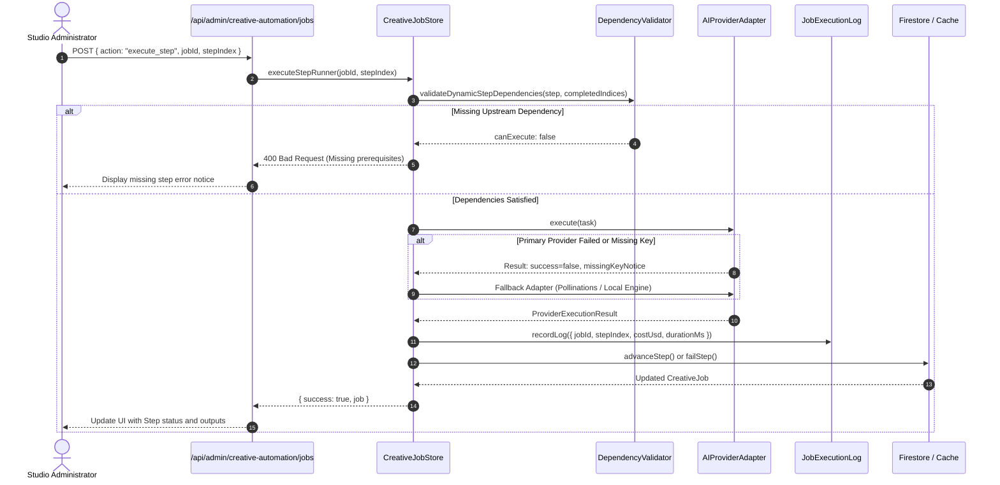

# 03 — Dynamic Workflow Engine & Orchestration

The Sutra Studio Workflow Engine orchestrates creative production processes from initial creative briefs through shot selection, media generation, quality gates, and export delivery.

---

## ⚙️ Orchestration Core: `CreativeJobStore`

`src/lib/creative-automation/jobStore.ts` manages job lifecycles with dual-mode persistence:

### 1. Dual-Mode Storage Architecture
- **Primary**: Firebase Firestore collections (`creative_jobs`, `job_execution_logs`).
- **Resilience Layer**: Dual-mode in-memory cache (`MEMORY_JOB_CACHE`, `MEMORY_LOG_CACHE`) enabling full functional execution in offline development, local staging, or network disconnection scenarios.

```typescript
// Example: Creating a new autonomous creative job
const job = await CreativeJobStore.createJob({
  brandId: "brand-sutra-flagship",
  clientUid: "admin-sutra-master",
  workflowId: "wf-dynamic-8-master",
  title: "Autumn 2026 AI Automation Showcase",
  category: "cinematic_video",
  targetDeliverables: {
    aspectRatio: "16/9",
    format: "MP4 (ProRes / H.264)",
    intendedPlatform: "commercial_broadcast",
  },
  brief: {
    topic: "Autonomous Creative Automation",
    targetAudience: "Creative Directors & Founders",
    keyMessage: "Bespoke digital experiences in 48 hours.",
    tone: "luxury_atelier",
  },
});
```

---

## 🔒 Dependency Validation Engine

Before executing any pipeline step, `validateDynamicStepDependencies` verifies that all upstream prerequisite steps have successfully completed:

```typescript
export function validateDynamicStepDependencies(
  step: WorkflowStepConfig,
  completedStepIndices: number[]
): { canExecute: boolean; missingDependencies: string[] } {
  const missing: string[] = [];

  if (step.dependsOnSteps && step.dependsOnSteps.length > 0) {
    for (const depIndex of step.dependsOnSteps) {
      if (!completedStepIndices.includes(depIndex)) {
        missing.push(
          `Step ${step.stepIndex} (${step.name}) requires Step ${depIndex} to be completed before execution.`
        );
      }
    }
  }

  return {
    canExecute: missing.length === 0,
    missingDependencies: missing,
  };
}
```

### Dependency Rules:
- **Step 1 (Brief)**: Requires no prerequisites.
- **Step 2 (Creative Direction)**: Requires Step 1.
- **Step 3 (Shot Planning)**: Requires Step 2.
- **Step 4 (Image Generation)**: Requires Step 3.
- **Step 5 (Video Generation)**: Requires Step 4 (Image-to-Video) or Step 3 (Text-to-Video).
- **Step 6 (Editing & Transitions)**: Requires Step 5.
- **Step 7 (Quality Assurance)**: Requires Step 6.
- **Step 8 (Export & Delivery)**: Requires Step 7.

---

## 🔁 Retry Handling & Cancellation

- **`retryStep(jobId, stepIndex)`**: Clears the step error state, resets `startedAt` and `completedAt`, sets status back to `pending`, and updates the overall job status back to `in_progress`.
- **`cancelJob(jobId, reason)`**: Terminates any pending executions, transitions job status to `cancelled`, and persists the cancellation reason in the audit ledger.

---

## 🛡️ Step Runner Execution Flow


