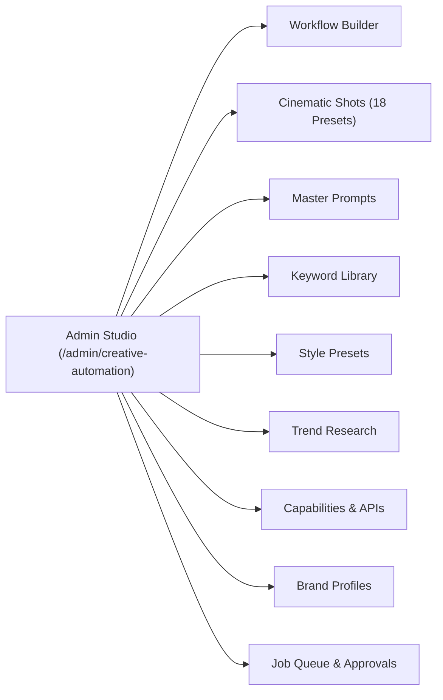

# 08 — Admin Dashboard Studio Integration

The **AI Creative Automation Studio** interface is embedded seamlessly within the Sutra Studio Admin Dashboard at `/admin/creative-automation`. Built using the warm ivory (`#FAF9F5`) and muted brass (`#A98B57`) design tokens, it offers complete administrative control without code modifications.

---

## 🧭 Navigation & Section Structure

---

## 🎛️ Section Walkthroughs

### 1. Workflow Builder (`Tab: workflows`)
- **Pipeline Selector**: Toggle between the **8-Step Dynamic Autonomous Pipeline** (`DYNAMIC_8_STEP_PIPELINE`) and legacy 14-step workflows.
- **Dynamic Step Cards**: View assigned capability types, required prerequisite dependencies, preferred AI adapters, and human approval gates.
- **Custom Template Duplication**: Duplicate production blueprints for specific client campaigns with one click.

### 2. Cinematic Shots Library (`Tab: shots`)
- **18 Visual Presets**: Dedicated inspection cards for all 18 camera movements, lens guidelines, aspect ratios, and durations.
- **Category Filter Pills**: Fast filtering by Architecture, Product, Brand Films, Aerials, and Social Motion.
- **Interactive Prompt Compiler**: Click **"Test Prompt"** on any preset to populate a live preview showing how subject, lighting, and camera vectors compile into production-ready prompts.

### 3. Master Prompts (`Tab: prompts`)
- Versioned master prompt templates categorized by Educational Reels, Screen Tutorials, Commercials, Cinematic Brand Films, and 3D Panoramas.
- Copy-to-clipboard functionality with instant visual toast notifications.

### 4. Keyword Library (`Tab: keywords`)
- Curated luxury atelier terminology across Lighting, Materials, Camera, Composition, and Aesthetic Movement tags.
- Direct keyword toggling for inclusion into generative pipelines.

### 5. Capabilities & APIs (`Tab: capabilities`)
- Real-time environment credential scanner checking API keys (`GEMINI_API_KEY`, `BFL_API_KEY`, `KLING_API_KEY`, `ELEVENLABS_API_KEY`).
- Clear status badges: `Configured API`, `Installed / Zero-Key`, `Adapter Ready`, or `Missing Key`.
- Displays estimated cost per unit and fallback routing options.

### 6. Job Queue & Approvals (`Tab: jobs`)
- **Live Step Progress Indicator**: Visual progress bar tracking `Step X of Y` with animated pulses for running stages.
- **Autonomous Step Controls**:
  - **Run Step**: Manually trigger autonomous step execution through the assigned AI provider adapter.
  - **Approve Step**: Pass a human approval gate and advance the job to the next stage.
  - **Retry Step**: Reset a failed or halted step for re-execution.
  - **Cancel Job**: Abort the pipeline run safely.
- **Step-by-Step Execution Ledger**: Expandable drawer displaying step outputs (model, provider ID, output URLs, text content), execution duration, and USD compute cost.
- **Google Drive Production Vault**: Status card displaying sync readiness with the configured root media folder.

---

## 🔐 Multi-Tenant Brand Switching

The top header features a **Tenant Selector**:
- Switch seamlessly between the Flagship Master profile (`brand-sutra-flagship`) and individual client accounts.
- Switching tenants immediately re-scopes color palettes, voice tones, negative style rules, and pipeline default deliverables.
