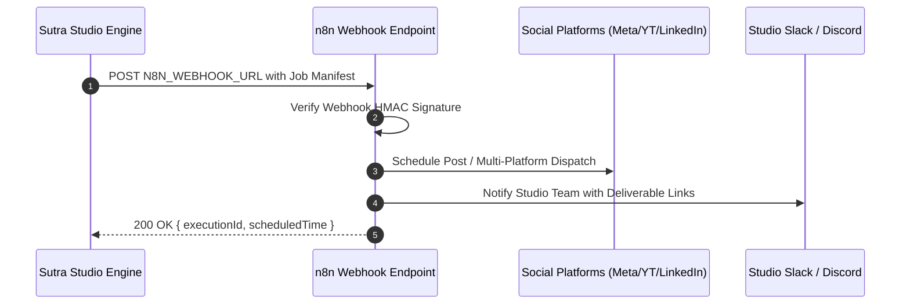

# 10 — n8n Workflow Orchestration & Distribution

Sutra Studio integrates with **n8n** (self-hosted or cloud) to handle asynchronous background tasks, scheduled multi-channel distribution (Instagram, YouTube Shorts, LinkedIn), and external notification dispatches without tying up Next.js serverless execution limits.

---

## 🔀 Integration Architecture



---

## 📡 Webhook Payload Contract

When Step 8 (Export & Delivery) completes, or when scheduled publishing is enabled, Sutra Studio emits a structured webhook payload:

```json
{
  "event": "creative_job.completed",
  "timestamp": "2026-10-13T10:45:00.000Z",
  "job": {
    "id": "job-mf39-abc",
    "title": "Autumn 2026 AI Automation Reel",
    "brandId": "brand-sutra-flagship",
    "category": "cinematic_video",
    "deliverables": {
      "aspectRatio": "16/9",
      "format": "MP4 (ProRes / H.264)",
      "intendedPlatform": "instagram_reels",
      "driveViewLink": "https://drive.google.com/file/d/1a2b3c4d5e/view",
      "thumbnailUrl": "https://image.pollinations.ai/prompt/..."
    },
    "copywriting": {
      "hook": "Deliver bespoke digital experiences in 48 hours.",
      "caption": "Step inside the new era of autonomous creative studio production. Built with Sutra Studio.",
      "hashtags": ["#CreativeTechnology", "#AIAutomation", "#DesignStudio", "#LuxuryAtelier"]
    }
  }
}
```

---

## 🔒 Security & HMAC Verification

To guarantee that incoming callbacks from n8n are authentic and have not been tampered with:
1. Every outbound webhook contains an `X-Sutra-Signature` header computed as:
   ```text
   HMAC-SHA256(payload_body, N8N_WEBHOOK_SECRET)
   ```
2. Inbound status updates from n8n back into `/api/webhooks/n8n` verify this signature before updating job records.

---

## 🔁 Failure Handling & Circuit Breakers

- **Exponential Backoff**: If n8n returns HTTP 500, 502, or 504, the dispatcher retries after 2s, 4s, and 8s intervals.
- **Audit Logging**: Every webhook dispatch result is persisted in `job_execution_logs` with latency metrics and delivery receipt IDs.
