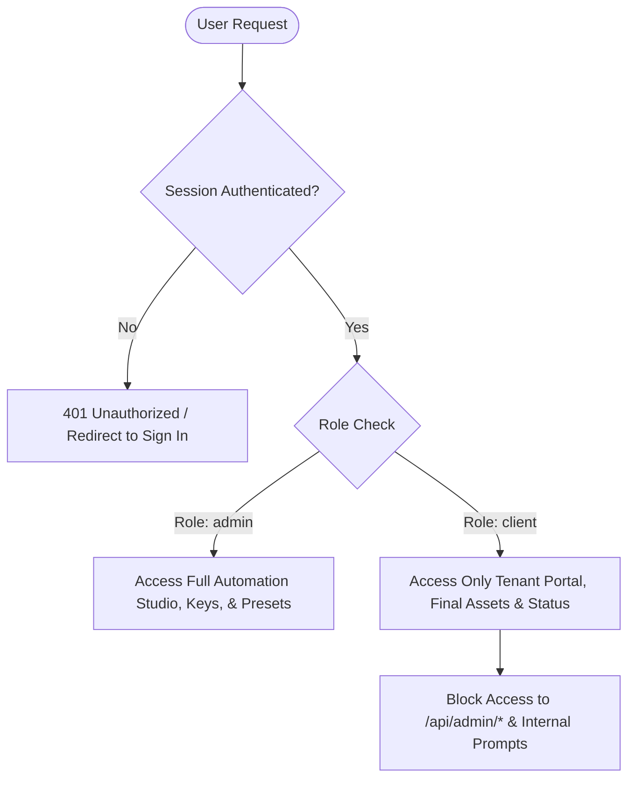

# 11 — Security, Roles & Secret Management

The AI Creative Automation Engine enforces enterprise-grade security standards to safeguard API credentials, client confidential assets, and studio data integrity.

---

## 🛡️ Role-Based Access Control (RBAC)

Sutra Studio enforces two distinct user domains:



### 1. Studio Administrator (`role: "admin"`)
- Full administrative authority over all pipelines, workflow templates, provider settings, and the job queue.
- Protected by `requireAdmin()` in server handlers and `<RouteGuard requiredRole="admin">` in UI views.

### 2. Client Brand Tenant (`role: "client"`)
- Scoped strictly to the client's own brand deliverables and approved assets (`/portal/*`).
- **Forbidden from accessing**:
  - Raw system prompts, provider configuration, or internal step logs.
  - Third-party API keys or rate-limit configurations.
  - Other client tenants' creative briefs or outputs.

---

## 🔒 Zero Client Leakage Policy

1. **Server-Side API Calling Only**:
   - Browser client components never call external AI providers (Gemini, BFL, Kling) directly.
   - All AI requests pass through server-side route handlers (`/api/admin/creative-automation/*`), keeping API keys securely in the Node.js runtime.
2. **Environment Key Hygiene**:
   - Secrets are declared in `.env.local` or host container environments without `NEXT_PUBLIC_` prefixes.
   - The provider capability scanner (`getLiveCapabilityRegistry()`) reports presence (`isConfigured: true/false`), never exposing the actual key string to the UI.

---

## 🌐 CSRF & Same-Origin Protection

Every mutating HTTP method (`POST`, `PUT`, `DELETE`) across the creative automation API invokes:

```typescript
if (!sameOrigin(req)) {
  return badRequest("Cross-origin request blocked.");
}
```

This prevents malicious third-party websites from executing cross-site request forgery attacks against administrative sessions.
